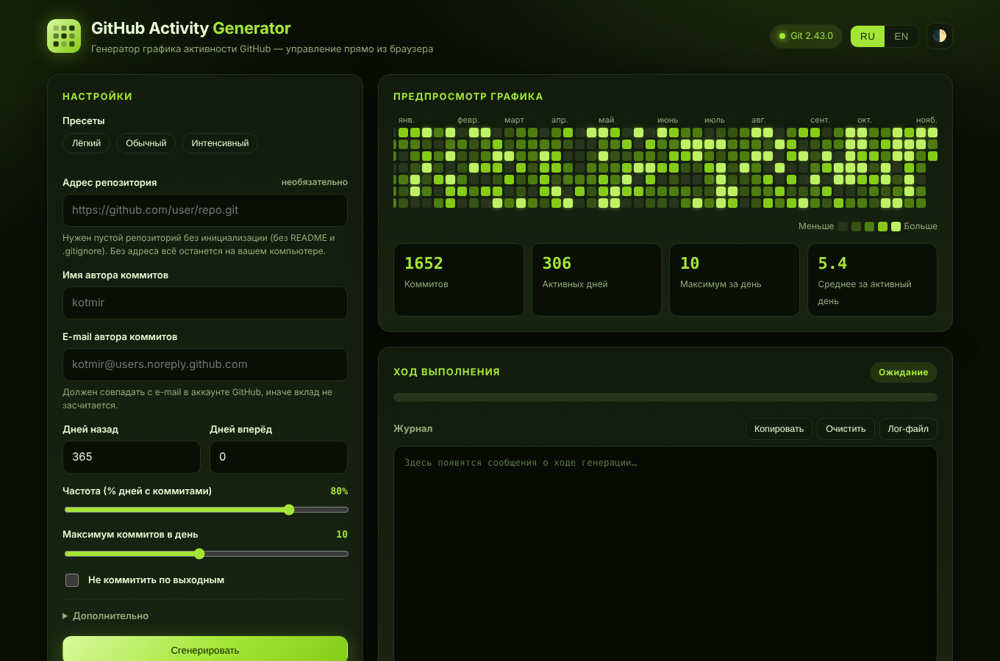

<div align="center">


# GitHub Activity Generator

**Русский · [English](#english)**

Генератор графика активности GitHub с удобным веб-интерфейсом · автор: **kotmir**



</div>

> ⚠ **Дисклеймер.** Инструмент создан в образовательных целях и для демонстрации
> механики GitHub. Не используйте его, чтобы выдавать искусственную активность
> за реальный профессиональный опыт.

## Что нового в версии 2.0

- 🖥 **Веб-интерфейс**: запуск двойным кликом по `start.bat` / `start.sh`, всё управление в браузере.
- 👀 **Предпросмотр графика** в реальном времени — вы видите будущий результат до генерации.
  Одинаковый *seed* = одинаковый график.
- 🌐 **Русский и английский** языки интерфейса и логов, переключение «на лету».
- 🍋 **Лаймовое оформление**, тёмная и светлая темы.
- 📜 **Логи**: живой журнал в интерфейсе + файл `logs/activity-generator.log` (с ротацией).
- ⏹ **Остановка** генерации в любой момент, индикатор прогресса.
- ⚡ **Режим пустых коммитов** — намного быстрее обычного.
- 🛡 Проверка всех входных данных, защита от «опасных» адресов репозитория,
  токены из URL маскируются в логах, сервер слушает только `127.0.0.1`.
- 🔧 Исправлены ошибки оригинала: кавычки в сообщениях коммитов, имя папки для URL без `.git`,
  зависание на запросе пароля, подпись коммитов (GPG) из глобальных настроек.
- ✅ Тесты и CI.

## Быстрый старт

Нужны **Python 3.8+** и **Git**. Сторонние библиотеки не требуются.

| ОС | Запуск |
|----|--------|
| Windows | двойной клик по `start.bat` |
| macOS / Linux | `./start.sh` |
| Любая | `python run.py` |

Браузер откроется сам на `http://127.0.0.1:8765/`. Если открыть `index.html` напрямую
из проводника, страница подскажет, что нужно запустить сервер.

1. Создайте на GitHub **пустой** репозиторий (без README, `.gitignore` и лицензии).
2. Вставьте его адрес в поле «Адрес репозитория» (или оставьте пустым — репозиторий
   останется локальным).
3. Укажите имя и **тот же e-mail, что в аккаунте GitHub** — иначе вклад не засчитается.
4. Посмотрите предпросмотр, при желании поправьте частоту и число коммитов.
5. Нажмите **«Сгенерировать»**. Готовый репозиторий появится в папке `output/`.

GitHub может обновлять график несколько минут. Для приватных репозиториев включите
[показ приватных вкладов](https://docs.github.com/ru/account-and-profile/setting-up-and-managing-your-github-profile/managing-contribution-settings-on-your-profile/showing-your-private-contributions-and-achievements-on-your-profile).

> **Авторизация при push.** Сервер не умеет вводить пароль, поэтому используйте SSH-ключ
> (`git@github.com:user/repo.git`) или HTTPS с настроенным менеджером учётных данных Git
> (в Windows он есть по умолчанию).

## Структура проекта

```
github-activity-generator/
├── index.html            # веб-интерфейс
├── assets/
│   ├── css/style.css     # лаймовая тема (тёмная + светлая)
│   ├── js/app.js         # логика интерфейса
│   ├── js/i18n.js        # словарь RU / EN
│   └── img/              # логотип, скриншоты
├── app/                  # Python-ядро
│   ├── config.py         # настройки и валидация
│   ├── planner.py        # расписание коммитов (без побочных эффектов)
│   ├── generator.py      # создание репозитория, коммиты, push
│   ├── gitops.py         # безопасная обёртка над git
│   ├── reporter.py       # логирование (файл + консоль + UI)
│   ├── i18n.py           # сообщения сервера RU / EN
│   ├── server.py         # локальный HTTP-сервер и API
│   └── cli.py            # командная строка
├── tests/                # unittest
├── run.py                # запуск веб-интерфейса
├── start.bat / start.sh  # запуск в один клик
├── contribute.py         # совместимая точка входа CLI
├── logs/                 # создаётся автоматически
└── output/               # сгенерированные репозитории
```

## Командная строка

Старая команда продолжает работать:

```sh
python contribute.py --repository=git@github.com:user/repo.git
python contribute.py -mc 12 -fr 60 -nw --seed 42 --mode empty --lang ru
```

| Параметр | Описание |
|----------|----------|
| `-r`, `--repository` | адрес пустого репозитория (если задан — выполняется push) |
| `-un`, `--user_name` / `-ue`, `--user_email` | автор коммитов |
| `-db`, `--days_before` / `-da`, `--days_after` | период: сколько дней назад / вперёд (сегодня не включается, если `-da 0`) |
| `-fr`, `--frequency` | процент дней с коммитами (0–100, по умолчанию 80) |
| `-mc`, `--max_commits` | максимум коммитов в день (1–20, по умолчанию 10) |
| `-nw`, `--no_weekends` | не коммитить по выходным |
| `--mode file\|empty` | дописывать `README.md` или пустые коммиты |
| `--seed N` | зерно случайности для повторяемого графика |
| `--out DIR` | папка вывода (по умолчанию `output`) |
| `--lang ru\|en` | язык логов |

## Логи

Все события пишутся в `logs/activity-generator.log` (до 5 файлов по 1 МБ). Уровень `DEBUG`
(по дням) попадает только в файл, в интерфейс — основные этапы. Файл можно скачать
кнопкой **«Лог-файл»**.

## Решение проблем

- **График не изменился** — подождите несколько минут; проверьте, что e-mail коммитов
  совпадает с e-mail в GitHub (`git config --get user.email`).
- **Push не прошёл** — репозиторий должен быть *пустым и неинициализированным*;
  проверьте доступ (SSH-ключ / менеджер учётных данных).
- **Git не найден** — установите его с <https://git-scm.com/> и перезапустите `start.bat`.
- **Порт занят** — сервер сам выберет следующий свободный, адрес будет в консоли.

## Тесты

```sh
python -m unittest discover -s tests -t . -v
```

---

<a id="english"></a>

<div align="center">

# English

GitHub contribution graph generator with a friendly web UI · author: **kotmir**

</div>

> ⚠ **Disclaimer.** This tool is for educational purposes and for demonstrating GitHub
> mechanics. Do not use it to present artificial activity as real professional experience.

## What's new in 2.0

- 🖥 **Web interface** — double-click `start.bat` / `start.sh` and control everything in the browser.
- 👀 **Live graph preview** — see the result before generating. The same *seed* gives the same graph.
- 🌐 **Russian and English** UI and logs, switchable on the fly.
- 🍋 **Lime design** with dark and light themes.
- 📜 **Logging** — live log in the UI plus a rotating `logs/activity-generator.log` file.
- ⏹ **Cancel** any time, progress bar.
- ⚡ **Empty-commit mode** — much faster.
- 🛡 Input validation, protection against dangerous repository URLs, tokens masked in logs,
  the server listens on `127.0.0.1` only.
- 🔧 Fixes for the original script: stray quotes in commit messages, folder name for URLs
  without `.git`, hanging on credential prompts, GPG signing from the global config.
- ✅ Tests and CI.

## Quick start

Requires **Python 3.8+** and **Git**. No third-party packages.

| OS | Run |
|----|-----|
| Windows | double-click `start.bat` |
| macOS / Linux | `./start.sh` |
| Any | `python run.py` |

Your browser opens at `http://127.0.0.1:8765/`. If you open `index.html` directly from the
file manager, the page will tell you to start the server first.

1. Create an **empty** repository on GitHub (no README, `.gitignore` or license).
2. Paste its URL into "Repository URL" (or leave it empty to keep the repo local).
3. Set the name and **the same e-mail as your GitHub account** — otherwise contributions are not counted.
4. Check the preview and tune frequency / commits per day if you like.
5. Press **"Generate"**. The finished repository appears in `output/`.

GitHub may need a few minutes to refresh the graph. For private repositories enable
[showing private contributions](https://docs.github.com/en/account-and-profile/setting-up-and-managing-your-github-profile/managing-contribution-settings-on-your-profile/showing-your-private-contributions-and-achievements-on-your-profile).

> **Push authentication.** The server cannot type a password for you, so use an SSH key
> (`git@github.com:user/repo.git`) or HTTPS with a configured Git credential manager
> (built into Git for Windows).

## Command line

The old command still works:

```sh
python contribute.py --repository=git@github.com:user/repo.git
python contribute.py -mc 12 -fr 60 -nw --seed 42 --mode empty --lang en
```

Options are listed in the table above (`python contribute.py --help` prints them too).

## Logs

Everything is written to `logs/activity-generator.log` (5 files × 1 MB). `DEBUG` entries
(per day) go to the file only; the UI shows the main stages. Download it with the
**"Log file"** button.

## Troubleshooting

- **The graph did not change** — wait a few minutes and make sure the commit e-mail matches
  the one in GitHub (`git config --get user.email`).
- **Push failed** — the remote must be *empty and not initialised*; check access
  (SSH key / credential manager).
- **Git not found** — install it from <https://git-scm.com/> and restart `start.bat`.
- **Port is busy** — the server picks the next free one; the address is printed in the console.

## Tests

```sh
python -m unittest discover -s tests -t . -v
```

## Credits & license

Author: **kotmir**. Based on [Shpota/github-activity-generator](https://github.com/Shpota/github-activity-generator)
by Shpota. Licensed under the [Apache License 2.0](LICENSE) — see also [NOTICE](NOTICE).
